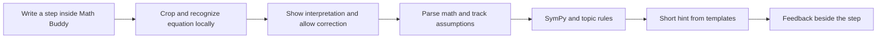

# Math Buddy — dedicated local application plan

Updated October 13, 2026.

## Scope and budget

Math Buddy is its own application: open it, upload a screenshot of a question, and write solution steps beneath that question. The application owns the writing workspace and shows feedback beside each submitted step.

This is a personal, local project. Target software/API spending is $0; treat $10 as the total ceiling if an optional purchase later becomes necessary. The recommended design needs no paid service, external hosting, or Apple developer membership.

Develop on the existing Windows laptop and use Math Buddy on the iPad. The intended curriculum is first-grade math through basic Calculus I, delivered in tested topic groups.

This document is the implementation plan. The application and models have not been installed, implemented, or benchmarked.

## Application format

Build a dedicated installable web app (PWA). It has its own Math Buddy icon and full-screen workspace on the iPad. Its frontend and backend are served by the Windows laptop over the home network.

Apple supports opening websites as Home Screen web apps. [Apple instructions](https://support.apple.com/en-ie/guide/ipad/ipad8f1f7a29/ipados).

For the first development test, a Safari tab is sufficient. Add the icon, web manifest, and locally trusted HTTPS when making the app convenient for daily use. Package scripts, fonts, models, and other assets locally so ordinary use does not call external services.

Your laptop must stay on and awake while the iPad uses the checker. Both devices must be on the same reachable network. Internet is needed for the initial downloads; subsequent checking can work without internet, with the local network still available.

Your laptop was inspected during planning: 16 GB RAM, Intel Core i7-13620H, NVIDIA RTX 4050 Laptop GPU. Local recognition experiments are reasonable on this hardware. Actual accuracy, speed, and GPU memory use remain to be measured.

## Screens and workflow

### Home

- New problem: upload PNG/JPEG screenshot or photo, or type a question.
- Continue a saved session.
- Settings: pen input, automatic checking, hint level, topic, and local connection status.

### Problem setup

- Crop the screenshot to one question.
- Display the original question.
- Recognize the equation and ask the user to confirm or edit the interpretation.
- Let the user type instructions or word-problem wording if the equation OCR does not read prose.
- Select the topic or confirm an inferred topic, including relevant assumptions such as real-valued variables.

### Solve workspace

Keep the question visible at the top and provide large writing areas underneath it. Each completed step gets feedback in the same workspace.

```text
┌──────────────────────────────────────────────┐
│ Math Buddy                       Saved ✓     │
│                                              │
│ [Uploaded question: 3(x + 2) = 15]            │
│                                              │
│ Step 1                                       │
│ [Handwriting: 3x + 6 = 15]                    │
│ ✓ Valid distribution                         │
│                                              │
│ Step 2                                       │
│ [Handwriting: 3x = 11]                        │
│ Check the subtraction on the right.          │
│                                              │
│ Pen   Eraser   Undo   Check step   Next step  │
└──────────────────────────────────────────────┘
```

Use Apple Pencil where available, with finger/mouse/keyboard input as alternatives. Store the original strokes so erasing and undo work.

Show a compact “I read this as…” equation under a submitted step. Allow editing that recognition without forcing the user to rewrite all their handwriting.

Feedback states:

- Verified step.
- Mathematical issue.
- Unclear handwriting: clarification needed.
- Incomplete step: continue writing.
- Unsupported or unresolved check.

Start with a Check step button. Later, enable checks after about 1–2 seconds without writing, after pen-up, when the expression appears complete. A pause alone does not mean a fraction or equation is finished.

Optional guided mode waits for checking before opening the next step. Otherwise leave the workspace writable and clearly mark pending checks. This makes error prevention practical without promising instant inference.

### Session history

Save question images, strokes, interpreted equations, corrections, and feedback on the laptop. Reopening a session restores the workspace. Editing an earlier step invalidates dependent checks. Keep an optional browser-side draft for writing that has not yet reached the laptop.

## Free technology stack

| Component | Choice | Purpose |
|---|---|---|
| Interface | React + TypeScript + Vite | Dedicated Math Buddy screens and step history |
| Writing canvas | Canvas + Pointer Events | Capture pen coordinates, pressure where available, and timing |
| Stroke display | perfect-freehand | Smooth handwriting; does not perform recognition |
| Equation rendering | KaTeX | Display interpreted math and hints |
| App-style installation | Web manifest + service worker | Icon, standalone window, and cached UI assets |
| Local backend | Python + FastAPI + Pydantic | Receive work and orchestrate checking |
| Recognition | UniMERNet-tiny through PyTorch | Convert cropped equation images to LaTeX |
| Math verification | SymPy + custom rules | Arithmetic, algebra, and calculus checks |
| Feedback | Written templates | Explain supported mistakes without a paid model |
| Storage | SQLite + local files | Session database, strokes, images, and revisions |
| Local HTTPS | mkcert + server TLS | Trusted local connection for app features |
| Launcher | Windows PowerShell script | Start the app and show its iPad address |

Implementation references: [Vite](https://vite.dev/guide/), [FastAPI](https://fastapi.tiangolo.com/), [Pointer Events](https://developer.mozilla.org/en-US/docs/Web/API/Pointer_events/Using_Pointer_Events), [perfect-freehand](https://github.com/steveruizok/perfect-freehand), [KaTeX](https://katex.org/docs/api).

Test actual Apple Pencil behavior, scrolling, palm contacts, undo, erasing, zoom, and rotation early. Browser input should not be assumed to behave identically to a native handwriting app.

## Recognition and AI choices

1. **UniMERNet-tiny: first candidate.** Download its model and tokenizer and run recognition on the laptop. The project offers tiny/small/base variants and handwritten-expression evaluation. Compare on the user's handwriting rather than infer accuracy from published scores. [Official repository](https://github.com/opendatalab/UniMERNet).
2. **Texo: lightweight fallback to evaluate.** Offers a browser implementation. Initially test it on the laptop; direct recognition on iPad is a later experiment requiring performance and compatibility checks. [Official repository](https://github.com/alephpi/Texo).
3. **pix2tex: comparison baseline.** Provides equation-image-to-LaTeX tooling. Test handwritten crops explicitly. [Official repository](https://github.com/lukas-blecher/LaTeX-OCR).
4. **Optional local Qwen model.** Evaluate a small model later if natural-language explanations or mixed image/prose interpretation are needed. Choose a size/quantization that fits measured GPU memory; keep mathematical verification separate. It is unnecessary for the first prototype. [Qwen3-VL](https://github.com/QwenLM/Qwen3-VL).

No foundational-model training is needed initially.

Save raw strokes, then rasterize one submitted step into a clean crop for equation recognition. One step area at a time avoids having to locate the latest line on an arbitrary notebook page.

For question screenshots with prose, preserve the original image and provide manual text correction initially. Equation OCR alone does not implement word-problem understanding or graph interpretation.

## Checking pipeline



Keep recognition, verification, and explanation distinct. Store the original problem, instructions, previous validated steps, variable domains, and restrictions.

Accept multiple valid solution paths. Mathematical validity and whether a step makes useful progress are separate judgments.

Important checking rules:

- Exact arithmetic for integers/fractions; handle rounding instructions separately.
- Expression equivalence under the relevant domains.
- Equation transformations or solution-set comparison where feasible. Comparing raw left-minus-right expressions between lines is insufficient.
- Restrictions when dividing or cancelling: cancelling x from x(x - 1) = 0 can lose the solution x = 0.
- Squaring may introduce extra solutions: track the need for later checking.
- Sign reversal in inequalities when justified.
- Derivative rules, including chain/product/quotient rules.
- Antiderivatives checked by differentiation, with integration constants and intervals.
- One-sided limits and undefined-domain substitutions.

SymPy supplies operations; the step-validation layer must be implemented around them. [Equation solving with domains](https://docs.sympy.org/latest/modules/solvers/solveset.html), [calculus](https://docs.sympy.org/latest/tutorials/intro-tutorial/calculus.html).

If verification is unresolved, show uncertainty. Numerical sampling can detect counterexamples but is not proof of equivalence.

The checker should identify an issue category and evidence. Feedback templates then give hints such as “Check whether you multiplied every term inside the parentheses.” Only use a specific hint when the checker can justify that category; otherwise give a broader hint.

Parse a limited mathematical grammar. Do not execute generated Python. Use computation time limits so a hard symbolic expression does not freeze the app.

## Curriculum rollout

| Stage | Coverage | Additional work |
|---|---|---|
| First version | Written arithmetic, fractions, linear equations, simplification | Exact arithmetic and equation transformations |
| Elementary methods | Carrying, borrowing, column arithmetic, long division | Preserve layout and intermediate marks |
| Algebra/precalculus | Powers, factoring, quadratics, inequalities, radicals, basic trig | Domains, branches, lost/extra solutions |
| Basic Calculus I | Common limits, derivatives, tangent lines, basic integrals | Operation-aware verification |
| Later extensions | Word-problem reasoning, graphs, geometry, counting drawings | Separate representations and checking logic |

The target remains first grade through basic Calculus I. Expand by tested groups. A final-answer check does not validate carrying/borrowing, and picture-based reasoning differs from equations.

## Build sequence and milestones

1. **Recognition experiment:** Test UniMERNet-tiny on about 30–50 real handwriting crops, including fractions, minus signs, exponents, and calculus notation. Record incorrect readings and delay. Compare alternatives if needed.
2. **Typed checker:** Build local arithmetic and linear-equation checks independently of handwriting. Demonstrate valid alternative paths and deliberate errors.
3. **Math Buddy workspace:** Build Home, screenshot cropping, problem display, writing steps, pen/eraser/undo, and feedback panels. Test actual iPad input.
4. **Connect recognition:** Load the model once at backend startup. Submit one crop, recognize, parse, verify, and display editable interpretation plus feedback.
5. **Session saving:** Add SQLite/local file storage, recovery, and revision-aware checking.
6. **App installation:** Add manifest/icon, trusted local HTTPS, Home Screen installation, and a Windows launcher.
7. **Broader math and automatic checks:** Add curriculum groups with evaluated rules, then pause-based submission and guided mode.

These estimates depend on experience: a narrow demo is plausibly a few weeks for someone familiar with React and Python. Reliable full-range support needs more iteration and should not be promised by a first prototype.

## Local connection and installation

During development:

- Run FastAPI on the laptop at 127.0.0.1:8000.
- Run Vite on the LAN interface at port 5173.
- Proxy /api from Vite to FastAPI, and have the browser use relative /api URLs.
- Open the Vite LAN URL on the iPad. It must not call the iPad's own localhost for the backend.

Vite documents LAN binding and proxy options. [Server configuration](https://vite.dev/config/server-options).

For daily use:

- Build the frontend.
- Serve the built UI and /api together from FastAPI over local HTTPS.
- Use a stable LAN IP if practical, for example through a router DHCP reservation.
- Generate a certificate covering that address with mkcert and configure the server to use it.
- Install only the public local CA certificate on the iPad and enable certificate trust.
- Open the app in Safari and add it to Home Screen.
- Permit the app's listening port on the private home network through Windows Firewall.

mkcert supports local certificates on Windows and documents mobile-device trust. Keep private certificate keys on the laptop. [mkcert](https://github.com/FiloSottile/mkcert), [Apple certificate-trust instructions](https://support.apple.com/en-us/102390).

The initial prototype can use HTTP in Safari. Trusted local HTTPS enables the intended secure-context app features without external hosting. Keep saved session content out of indiscriminate service-worker API caching.

The laptop remains the computing device. Cached UI assets alone cannot check new steps when the laptop is unavailable. Display connection status and preserve unsent writing for reconnection.

Use native Windows Python initially. WSL2 is a fallback if recognition dependencies require Linux tooling, with additional LAN configuration evaluated separately.

## Tools and planned project layout

Install VS Code, Git, a supported Node.js LTS version, and Python compatible with the model. UniMERNet's quick-start uses Python 3.10. Use an isolated Python environment and PyTorch compatible with the NVIDIA driver. Verify GPU acceleration rather than assume it.

Python dependencies include FastAPI, Uvicorn, Pydantic, SymPy, Pillow, and recognition dependencies. Python includes SQLite support.

Proposed structure; these folders have not been created:

```text
Mathbuddy/
  frontend/              # Screens, canvas, feedback, app manifest
  backend/
    app.py               # API and serving built UI
    recognition/         # Model loading and preprocessing
    checking/            # Arithmetic/algebra/calculus rules
    feedback/            # Hint templates
    storage/             # Sessions and revisions
  models/                # Downloaded models/tokenizers
  data/                  # SQLite and local session files
  sample_work/           # Personal evaluation examples
  certs/                 # Local TLS files; keep out of version control
  start-mathbuddy.ps1     # Future launcher
  MATH_BUDDY_PLAN.md
```

Initial API endpoints: health, problem recognition, step checking, and session load/save. A check response includes step_id, revision, recognized_latex, status, verification_basis, issue_type, and message.

## Budget

| Item | Planned spending |
|---|---|
| Development tools and interface libraries | $0 |
| Local recognition models | $0 |
| SymPy and template feedback | $0 |
| SQLite and local session storage | $0 |
| Local HTTPS and Home Screen installation | $0 |
| Existing Windows laptop and iPad | No new hardware purchase planned |
| Optional local language model | No API fee; benchmark existing hardware |
| Recommended total | $0 |

The $5–$10 is an unused contingency, not a required payment. If recognition is inadequate, first compare free models, improve crops, and add quick recognition correction. Any paid fallback needs its entire cost evaluated against the $10 ceiling; do not add a subscription or setup fee that exceeds it.

Use finger input initially if a compatible pencil is unavailable. No GPU, Mac, domain, or hosting purchase is part of the plan.

## Verification and first success criterion

Use personal examples covering valid, wrong, unclear, and incomplete steps. Repeat them as typed math to separate recognition errors from verifier errors.

As each topic is added, test sign mistakes, distribution, fraction errors, carrying/borrowing, inequality reversal, lost/extra solutions, derivative rules, and integration constants. Include skipped intermediate steps and different valid methods.

Test erasing, rechecking, earlier-step edits, stale replies, rotation, palm contacts, Wi-Fi interruption, laptop sleep, and session reopening.

The first successful session happens entirely inside Math Buddy: upload a problem, write a valid step, make a deliberate error, receive an accurate hint, correct it, and continue. Establish arithmetic and linear equations first, then add a basic derivative after its checker exists.
